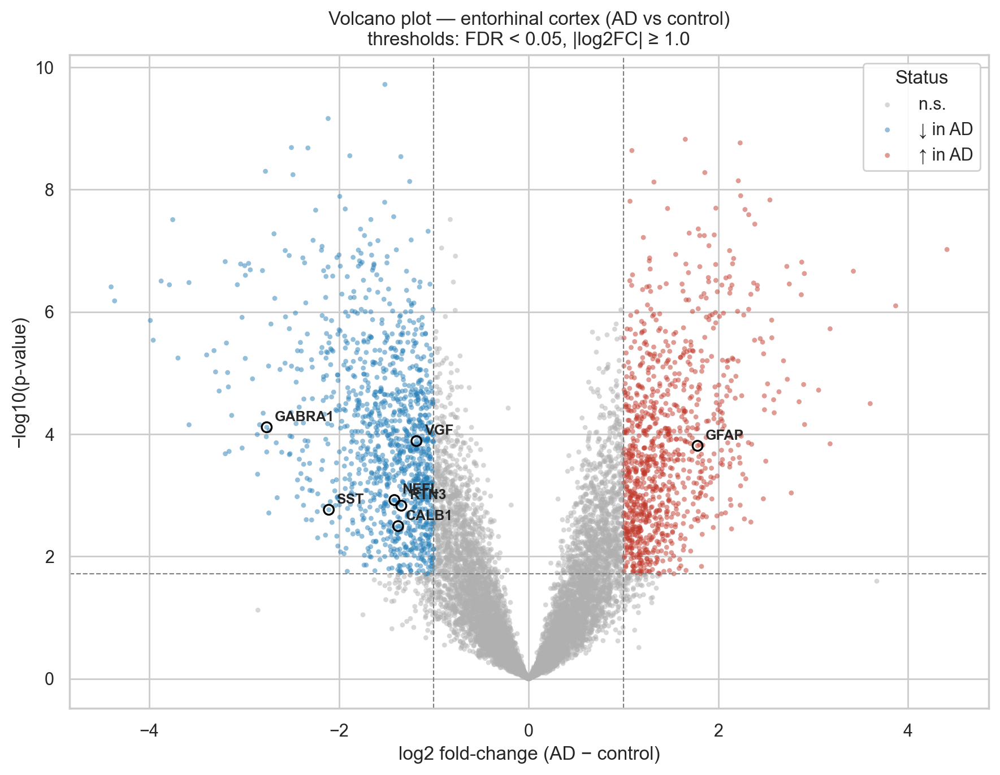
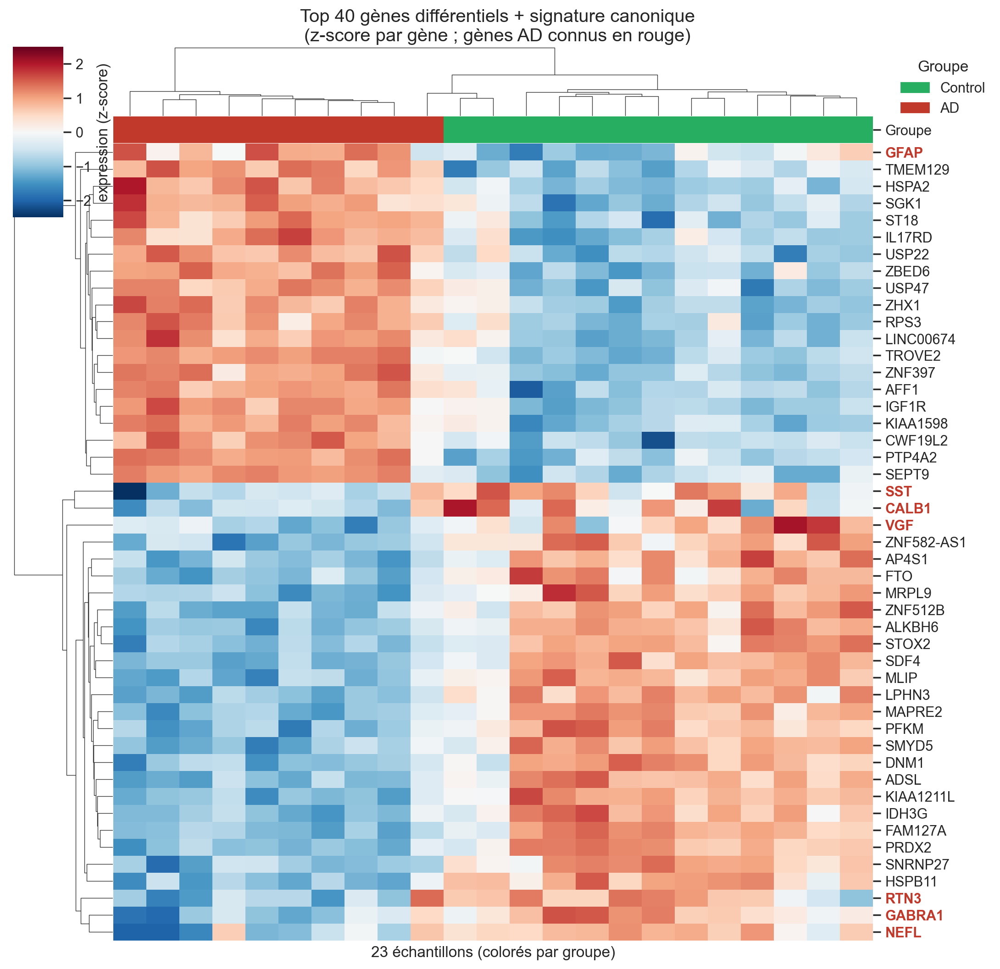
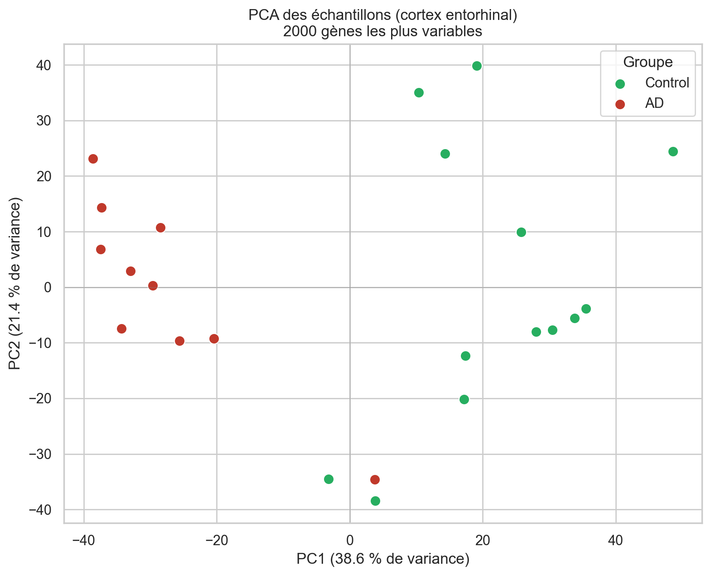

# Differential Gene Expression in Alzheimer's Disease — Entorhinal Cortex (GSE5281)

A reproducible transcriptomic analysis comparing brain tissue from **Alzheimer's disease (AD) patients** and **healthy aged controls**, focused on the **entorhinal cortex** — the earliest region affected by AD pathology.

> **About this project.** I hold a PhD in biotechnology (Alzheimer's disease, neuronal models) and a Data Scientist certification (Liora / Mines Paris-PSL). I wanted a pipeline I could check against biology I know: modular `src/`, version-controlled notebooks, reproducible environment, and every methodological choice written down.

---

## Why the entorhinal cortex?

Alzheimer's disease does not strike the brain uniformly. Neurofibrillary degeneration begins in the **entorhinal cortex** (Braak stages I–II), long before symptoms appear. Restricting the analysis to this single region — rather than pooling heterogeneous brain areas — keeps the biological signal coherent and the results directly interpretable.

**Dataset.** [GSE5281](https://www.ncbi.nlm.nih.gov/geo/query/acc.cgi?acc=GSE5281) (Liang *et al.*, 2008), Affymetrix Human Genome U133 Plus 2.0 microarray (GPL570, 54,675 probes), laser-captured neurons across several brain regions. After filtering to the entorhinal cortex:

| Group | n |
|-------|---|
| Alzheimer's disease | 10 |
| Healthy aged control | 13 |
| **Total** | **23** |

---

## Pipeline

The analysis is split into four narrated notebooks, backed by reusable functions in [`src/`](src/).

| Notebook | Step | Key choices |
|----------|------|-------------|
| [`01_data_acquisition`](notebooks/01_data_acquisition.ipynb) | Download GSE5281 via `GEOparse`, local caching | — |
| [`02_exploration_qc`](notebooks/02_exploration_qc.ipynb) | Sample metadata, group counts, QC | log2 transform · quantile normalization |
| [`03_differential_expression`](notebooks/03_differential_expression.ipynb) | Probe filtering, collapse, statistics | ABS_CALL filter · max-mean collapse · Welch *t*-test · Benjamini-Hochberg |
| [`04_visualization_biology`](notebooks/04_visualization_biology.ipynb) | Figures + biological interpretation | volcano · heatmap · PCA |

**Methodological decisions, made explicit:**

- **Quantile normalization** (after log2) — per-array medians ranged 35→117 (≈3.3× spread); aligning the full distribution, not just the median, makes arrays comparable for probe-wise testing.
- **Probe detection filter (`ABS_CALL`)** — keep probes called *Present* in at least `k` samples, with `k =` size of the smallest group (here **10**). This preserves markers specific to one group while removing ~35% of probes that are pure background. 54,675 → **19,202** probes.
- **Probe → gene collapse (max-mean)** — per gene, keep the probe with the highest mean intensity (best signal-to-noise). Probes with **no gene symbol** (2,070) or **multiple symbols** (1,025) are discarded rather than mapped arbitrarily. Final matrix: **10,571 unique genes**.
- **Welch's *t*-test** — unequal variances and unbalanced groups (10 vs 13); more robust than Student's *t*-test at no cost when variances are equal.
- **Benjamini-Hochberg** — controls the false discovery rate across ~10,000 simultaneous tests.

---

## Results

**4,082 genes** are differentially expressed at **FDR < 5 %**; **2,156** also exceed a 2-fold change (|log2FC| ≥ 1) — **990 up** and **1,166 down** in AD.

### Volcano plot
Genome-wide view of effect size vs significance. Canonical AD genes are circled and labelled.



### Heatmap — top differential genes + canonical signature
Per-gene z-scores; samples and genes clustered by similarity. The two groups separate into coherent blocks; known AD genes are highlighted in bold red.



### PCA of samples
Unsupervised projection on the 2,000 most variable genes. **PC1 (38.6 % of variance) separates AD from controls without ever using the group labels** — an independent confirmation that the differential signal dominates the data.



---

## Biological interpretation

### The canonical AD signature is recovered

| Gene | log2FC (AD − ctrl) | FDR | Expected role | Direction |
|------|-------------------:|----:|---------------|-----------|
| **GFAP** | +1.78 | 0.0014 | Reactive astrogliosis | ↑ as expected |
| **CD44** | +2.91 | 0.001 | Glial / inflammatory | ↑ as expected |
| **SPP1** | +2.91 | <0.001 | Glial / inflammatory | ↑ as expected |
| **GABRA1** | −2.76 | 0.0009 | GABAergic synaptic | ↓ as expected |
| **SST** | −2.11 | 0.0078 | Interneuron marker | ↓ as expected |
| **NEFL** | −1.41 | 0.0059 | Neurofilament (neuronal) | ↓ as expected |
| **CALB1** | −1.38 | 0.0125 | Calcium-binding neuronal | ↓ as expected |
| **RTN3** | −1.34 | 0.0069 | Neuronal, APP processing | ↓ as expected |
| **VGF** | −1.18 | 0.0012 | Neurosecretory / synaptic | ↓ as expected |

#### Neuronal markers down, glial markers up

The entorhinal cortex is one of the first regions reached by tau pathology, well before clinical symptoms, which makes it a sensible place to look for an early signature.

The neuronal and synaptic markers fall: SST (somatostatin, inhibitory interneurons), GABRA1 (GABA-A receptor), NEFL (neurofilament light), CALB1 (calbindin) and VGF (neuropeptide linked to synaptic plasticity). The glial and inflammatory markers rise: GFAP (reactive astrocytes), CD44 and SPP1. The volcano plot shows both groups on opposite sides.

A caveat on reading this: GSE5281 uses laser-captured neurons, so these differences reflect the sampled cells' expression and possible contamination or cell-composition shifts, not a direct count of neuronal loss. The glial/neuronal reading is consistent with the literature, but this dataset alone does not prove it.

### The "famous" AD genes are NOT differentially expressed — and that is expected

| Gene | log2FC | FDR | Significant? |
|------|-------:|----:|:---:|
| APP | +0.34 | 0.080 | no |
| MAPT (tau) | +0.00 | 0.993 | no |
| PSEN1 | −0.08 | 0.841 | no |
| APOE | −0.41 | 0.396 | no |

These genes drive AD through **post-translational** mechanisms (APP cleavage, tau hyperphosphorylation, APOE isoforms) — not mRNA abundance. A transcriptomic analysis *cannot* be expected to flag them.

Alzheimer's best-known genes are not differentially expressed here. MAPT (tau) is produced at normal levels and becomes pathological through hyperphosphorylation. APP is stable, and its cleavage by secretases generates the amyloid peptides. PSEN1 encodes the catalytic subunit of gamma-secretase, so its contribution lies in enzymatic activity. APOE acts through allele-specific protein isoforms. A differential expression analysis measures transcript levels and cannot see these mechanisms.

### Methodological caveats (scientific honesty)

Modest sample size (10 vs 13); microarray data (2007), less sensitive than current RNA-seq; age/sex verified comparable between groups (notebook 02) but not explicitly modelled; the high proportion of significant genes (~39 %) reflects a genuinely strong biological effect *and* the absence of a multivariate model. A publication-grade analysis would use `limma` (linear model + empirical-Bayes moderated variance). These trade-offs are deliberate for a pipeline-focused portfolio project.

---

## Reproduce the analysis

```bash
pip install -r requirements.txt
# run the notebooks in order (01 → 04)
jupyter lab
```

GEO data is downloaded and cached automatically into `data/raw/` (not version-controlled). Python 3.14; all package versions pinned in [`requirements.txt`](requirements.txt).

---

## Project structure

```
alzheimer-gene-expression/
├── notebooks/      Narrated analysis, step by step (01 → 04)
├── src/            Reusable modules
│   ├── data_loader.py     GEO download + local cache
│   ├── preprocessing.py   metadata, expression matrix, log2, normalization,
│   │                      ABS_CALL filter, probe→gene collapse
│   ├── stats.py           Welch t-test, log2FC, Benjamini-Hochberg
│   └── plotting.py        volcano, heatmap, PCA
├── data/           raw/ + processed/ (not version-controlled)
├── results/
│   ├── figures/    publication-quality figures
│   └── tables/     full differential-expression table (CSV)
├── requirements.txt
└── LICENSE         MIT
```

---

## Skills demonstrated

- **Domain-driven analysis** — biological questions framing every technical decision (region choice, probe filtering, interpretation of null results).
- **Reproducible engineering** — modular `src/`, pinned environment, clean git history, data kept out of version control.
- **Statistics** — multiple-testing correction, robust hypothesis testing, normalization, unsupervised validation (PCA).
- **Communication** — narrated notebooks and figures legible to both technical and biological audiences.

---

## References

- Liang WS, *et al.* **Alzheimer's disease is associated with reduced expression of energy metabolism genes in posterior cingulate neurons.** *PNAS* (2008). — origin study of GSE5281.
- Benjamini Y, Hochberg Y. **Controlling the false discovery rate.** *J. R. Stat. Soc. B* (1995).
- Braak H, Braak E. **Neuropathological stageing of Alzheimer-related changes.** *Acta Neuropathol.* (1991).

---

*Data: NCBI GEO accession [GSE5281](https://www.ncbi.nlm.nih.gov/geo/query/acc.cgi?acc=GSE5281). Code released under the MIT License.*
